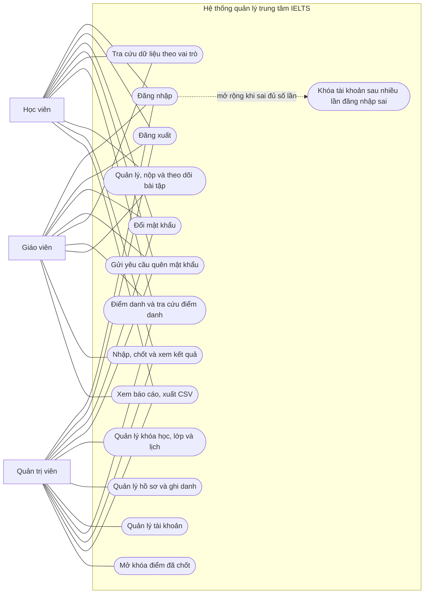
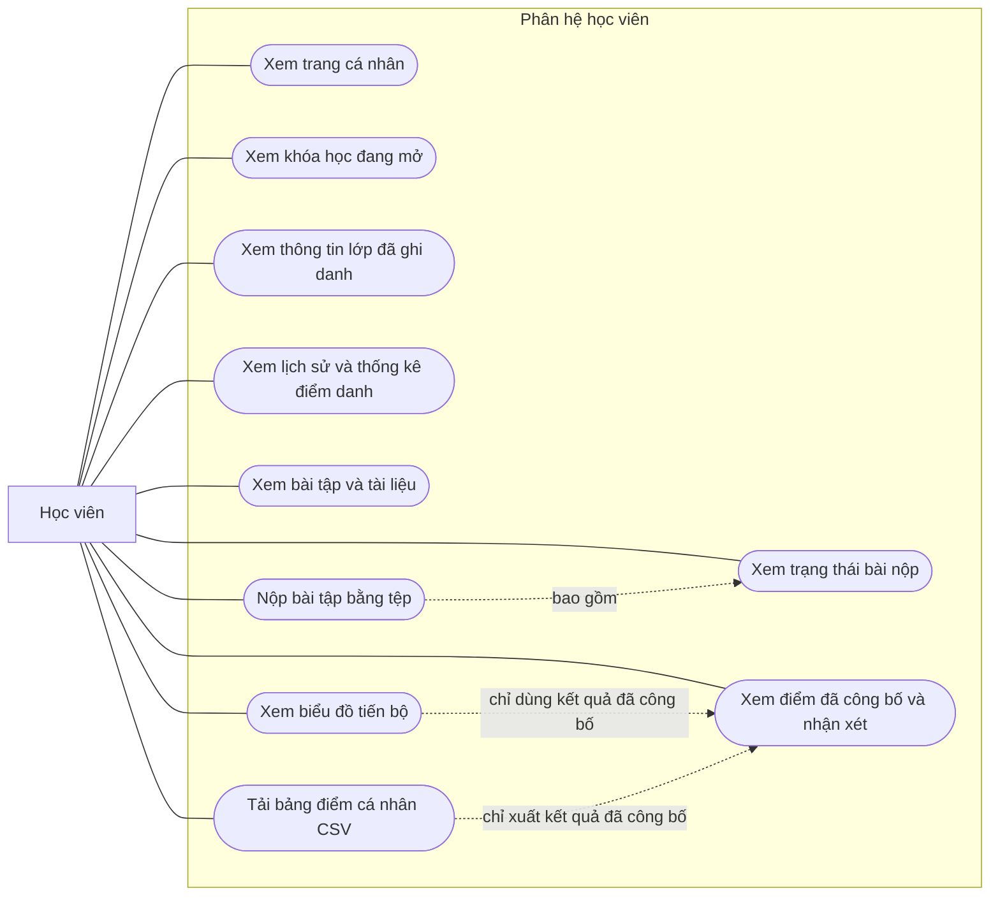
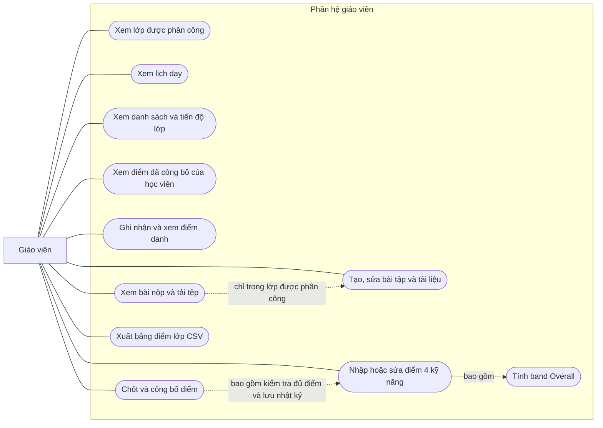
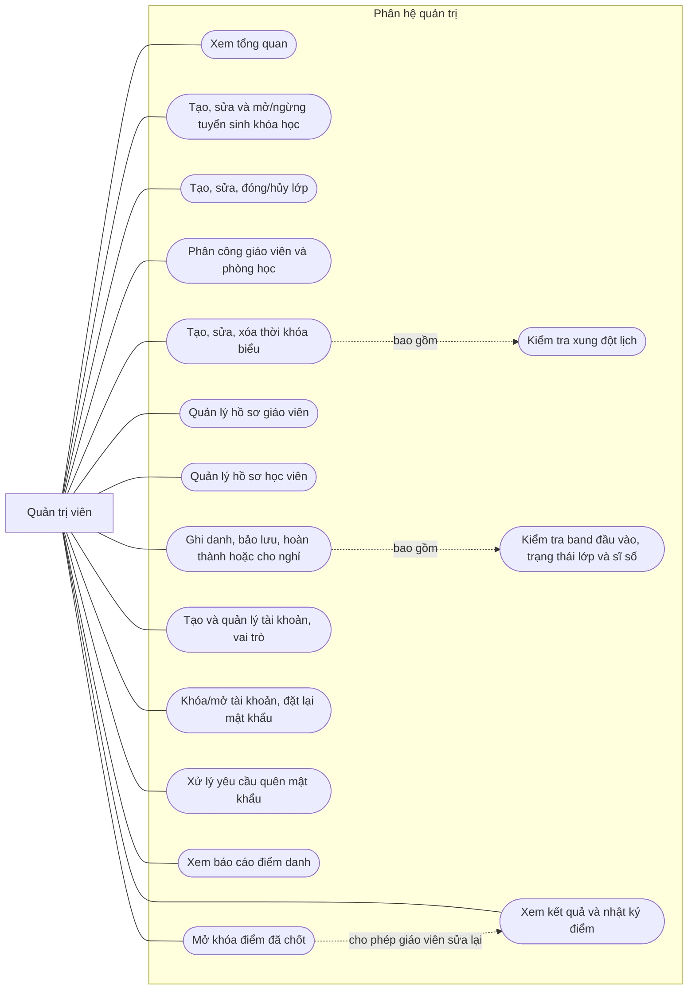
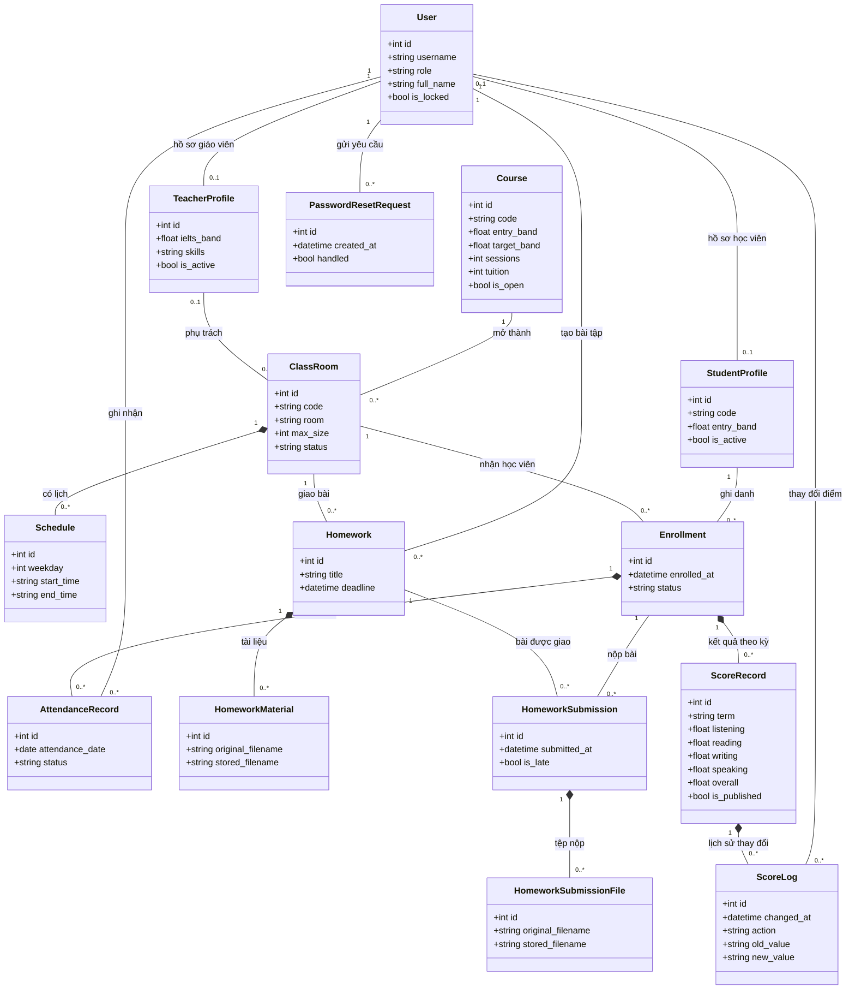
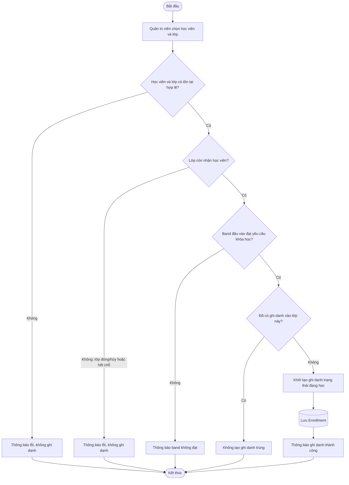
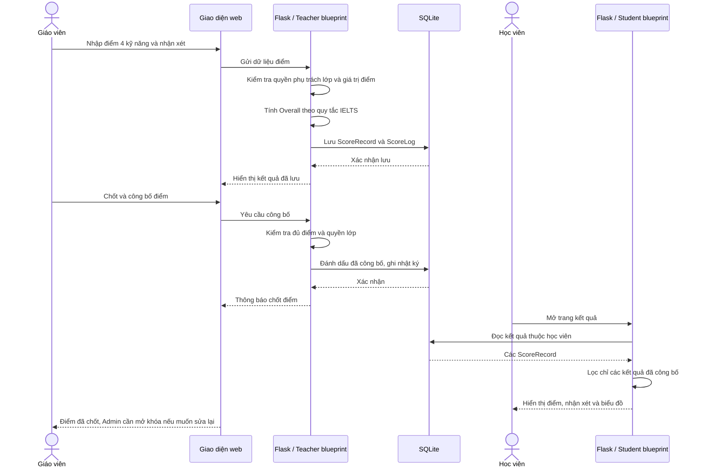
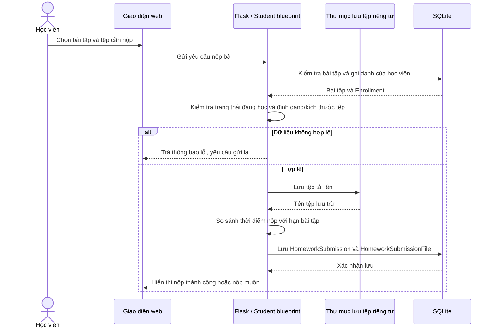
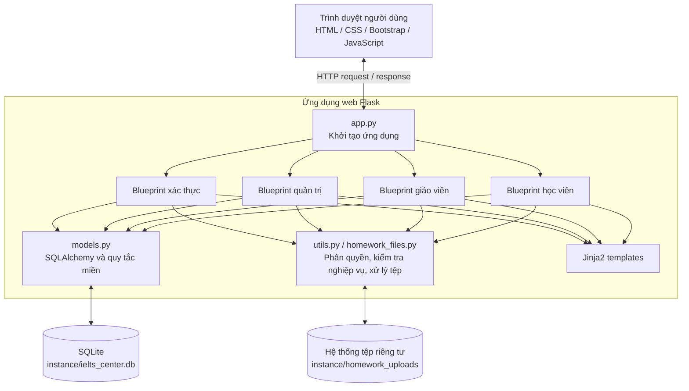

# Phân tích và thiết kế hệ thống quản lý trung tâm IELTS

## 1. Phạm vi và tác nhân

Các sơ đồ phản ánh chức năng hiện có trong ứng dụng Flask, các blueprint và README:

- **Học viên (Student):** xem khóa học đang mở, lớp đã ghi danh, điểm danh, bài tập, kết quả đã công bố; nộp bài và tải bảng điểm CSV.
- **Giáo viên (Teacher):** xem lớp được phân công và lịch dạy; điểm danh; giao/quản lý bài tập; nhập, chốt và xuất điểm.
- **Quản trị viên (Admin):** quản lý khóa học, lớp, lịch, hồ sơ học viên/giáo viên, ghi danh, tài khoản; xem báo cáo điểm danh/kết quả và mở khóa điểm.
- **Hệ thống:** xác thực và phân quyền, kiểm tra ràng buộc nghiệp vụ, tính Overall, lưu dữ liệu và nhật ký điểm.

Không mô hình hóa thanh toán, điểm danh tự động, email đặt lại mật khẩu, nhắn tin hay lớp học trực tuyến vì đây không phải chức năng hiện có.

## 2. USE CASE tổng quát

## 3. USE CASE phân rã theo vai trò

### 3.1. Học viên (Students)

### 3.2. Giáo viên (Teachers)

### 3.3. Quản trị viên (Admin)

## 4. Biểu đồ lớp phân tích (mô hình miền)

Biểu đồ tập trung vào các thực thể dữ liệu và quan hệ chính đang được ánh xạ bằng SQLAlchemy.

## 5. Biểu đồ hoạt động: ghi danh học viên vào lớp

## 6. Biểu đồ tuần tự: nhập và công bố điểm

## 7. Biểu đồ tuần tự: học viên nộp bài tập

## 8. Biểu đồ thành phần và triển khai

## 9. Quy tắc và giới hạn nghiệp vụ thể hiện trong thiết kế

- Giáo viên chỉ thao tác với lớp được phân công; học viên chỉ truy cập dữ liệu ghi danh của chính mình.
- Điểm kỹ năng nằm trong khoảng 0.0–9.0 theo bước 0.5; Overall là trung bình bốn kỹ năng và được làm tròn theo quy tắc band IELTS.
- Học viên chỉ xem được điểm đã công bố. Giáo viên không sửa được điểm đã chốt cho đến khi quản trị viên mở khóa.
- Ghi danh kiểm tra band đầu vào, trạng thái lớp, sĩ số; lịch học được kiểm tra xung đột giờ, giáo viên và phòng.
- Bài nộp được gắn cờ nộp muộn nếu thời điểm nộp vượt hạn. Điểm danh và tệp bài tập được giới hạn theo quyền/lớp tương ứng.
- Yêu cầu quên mật khẩu được lưu để quản trị viên xử lý thủ công; hệ thống không gửi email đặt lại tự động.
